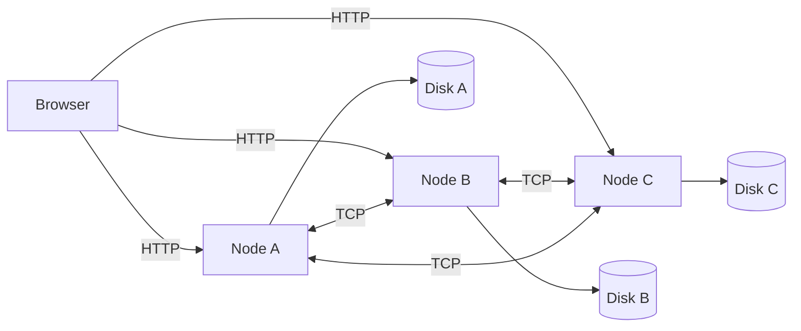
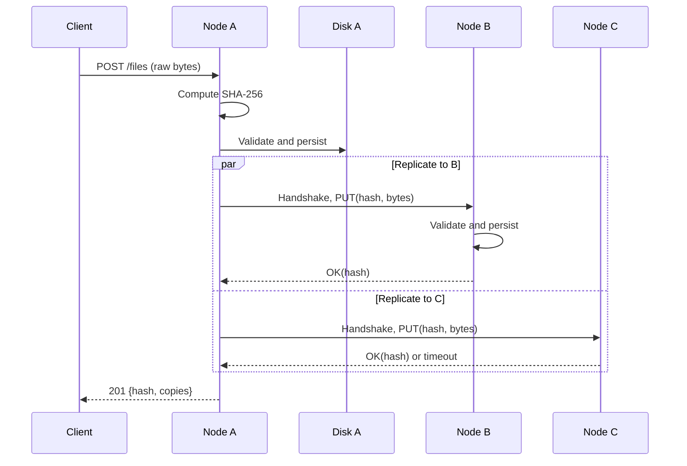
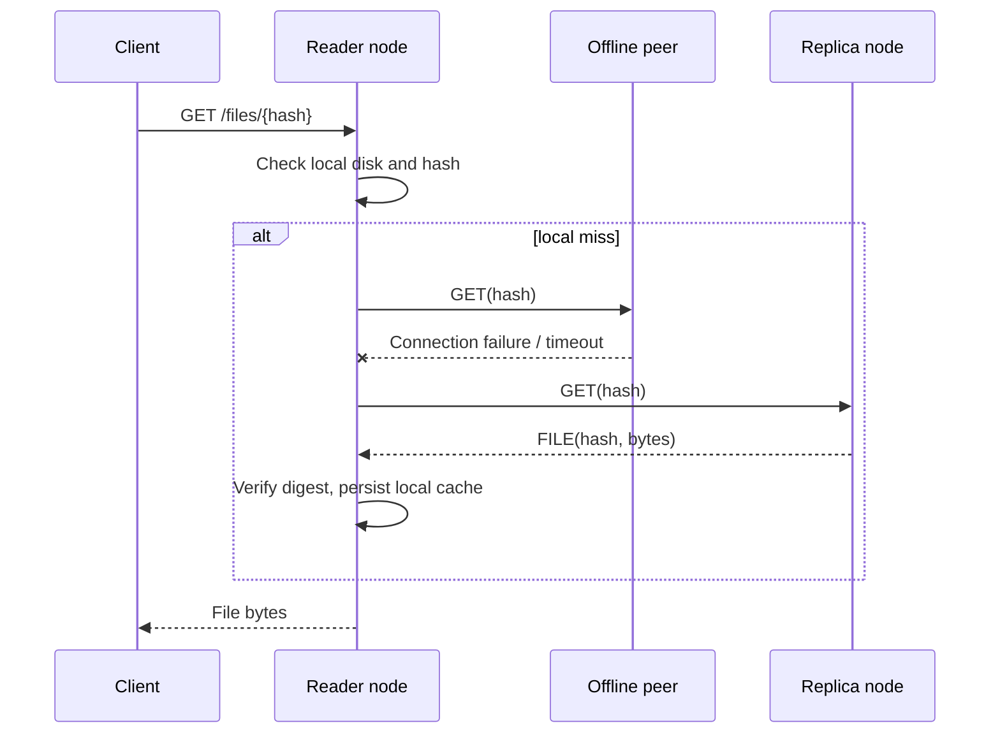

# Distributed File Storage System

A small decentralized content-addressed storage system (CAS) written in Go. Every node runs the same program, owns its own local disk directory and can receive uploads or serve downloads. There is no master, central metadata database, DHT or consensus protocol.

## Quick start

Requirements: Go 1.22 or newer. From the repository root run `go test ./...` and `go build ./...`. Open three terminals and start one command in each:

```sh
go run . -tcp 127.0.0.1:3001 -http 127.0.0.1:8081 -data data/a -peers 127.0.0.1:3002,127.0.0.1:3003
go run . -tcp 127.0.0.1:3002 -http 127.0.0.1:8082 -data data/b -peers 127.0.0.1:3001,127.0.0.1:3003
go run . -tcp 127.0.0.1:3003 -http 127.0.0.1:8083 -data data/c -peers 127.0.0.1:3001,127.0.0.1:3002
```

Open http://127.0.0.1:8081 and upload a small file. Copy the returned hash and check the status pages of the other nodes. Stop node A, then download using the same hash at node B or C. A successful upload reports the number of acknowledged copies, including the local one. Use distinct directories and ports; configuration is static, and all peers should be configured for a full mesh. Docker and deployment are intentionally not part of this version.

## System design



Each node has two listeners: HTTP for clients, TCP for peer operations. The HTTP API is a convenience layer, not centralized coordination. Each node can independently store data, replicate to configured peers, retrieve data from peers and cache it locally. Peers are bootstrap addresses supplied on the command line; no discovery or transitive routing is performed. The configured topology determines which nodes can communicate. For a small educational cluster, a full mesh is simplest.

### Source map

| File | Responsibility |
| --- | --- |
| `main.go` | CLI flags, node assembly and process entry point |
| `storage.go` | SHA-256 addresses, file persistence, validation, locking |
| `node.go` | Replication, remote retrieval, peer request dispatch |
| `http.go` | HTTP API and browser dashboard |
| `p2p/transport.go` | Original peer and transport interfaces |
| `p2p/tcp_transport.go` | TCP peer wrapper, wire messages, framing, protocol handshake, timeouts and connection lifecycle |
| `main_test.go` | Integration tests for replication, offline retrieval, concurrent writes and HTTP |
| `p2p/tcp_transport_test.go` | Real loopback TCP transport test |

### Data model and local storage

The identifier is the lowercase hexadecimal SHA-256 digest of the exact file bytes (64 characters). It is a content address, not the original filename. Identical bytes produce the same address and repeated uploads are idempotent. Changing a byte produces a different address with overwhelming probability. A hash provides integrity checking, not secrecy or authentication. Original filenames are not persisted; clients must retain the hash to retrieve a file. Each node stores one regular file per hash in its configured directory. Incoming hashes are validated before constructing paths; incoming content is rehashed before a write, and reads are verified as well. The maximum file size is 8 MiB. A temporary file in the same directory is written, synced, closed, and renamed to the final hash path. The final file is not exposed while a write is in progress. An in-process read/write mutex coordinates access, preventing duplicate concurrent writes and partial reads. A directory belongs to exactly one process; the mutex is not an interprocess lock. The rename is not a promise of crash durability on every filesystem (the directory itself is not synced).

### Write path



The local write is required; a failed local write fails the upload. Replication then proceeds concurrently to configured peers, and the response waits for the attempts to finish. A peer acknowledges only after its store accepts the bytes. The node counts local storage and successful remote acknowledgments, not an assumed replication factor. Incoming peer PUTs don't recursively replicate: this prevents loops and duplicate network amplification. Replication is best effort and does not roll back a successful local write if another peer is offline. A client can repeat the same upload to attempt replication again. There is no background repair or periodic replication.

### Read path and failure behavior



The read path prefers valid local bytes. On a miss or corrupt local copy, it tries configured peers in order, skips failures or invalid responses, validates the returned bytes and saves a local copy before returning. A peer GET only searches that peer's local disk. If no directly configured peer has valid bytes, the API returns 404. The system can tolerate an offline node if a reachable peer still has a copy. It cannot guarantee availability during network partitions or if all copies are lost. A restart preserves files on disk, but does not trigger replication or membership discovery.

### TCP protocol

TCP is an ordered byte stream: one write is not guaranteed to equal one read. The transport uses a four-byte unsigned big-endian payload length followed by exactly that many bytes of JSON. Reads use `io.ReadFull` to handle fragmentation. Writes use `io.Copy` so short writes are handled. JSON byte slices are base64 encoded automatically. Frames larger than 12 MiB or zero-length frames are rejected before allocating the payload. The 12 MiB bound accommodates base64 expansion of an 8 MiB file.

Every outbound connection dials the peer, sends a framed `dfs/1` hello, and expects the same protocol version in response. The accepted inbound peer reads first and responds only if the version matches. This handshake rejects incompatible versions; it does **not** prove the remote node's identity. After the handshake, each connection processes one request and one reply before closing. No multiplexing or persistent connections are needed in this small implementation. TCP dial timeout is 2 seconds and the established connection has a 5-second deadline covering handshake and request. The listener limits concurrent inbound connections to 32; closing the transport closes the listener and its tracked inbound sockets. The original transport constructor, peer wrapper, outbound flag and ListenAndAccept pattern have been retained; the previous incoming handler only logged a connection, and the new handler implements the full protocol.

| Request operation | Fields | Response |
| --- | --- | --- |
| `dfs/1` | none | `dfs/1` if compatible |
| `ping` | none | `ok` |
| `put` | hash, data | `ok` with hash or `error` |
| `get` | hash | `file` with hash/data or `error` |

### HTTP interface

| Method and endpoint | Input | Result |
| --- | --- | --- |
| `GET /` | none | browser dashboard |
| `POST /files` | raw file bytes, not multipart | 201 JSON `hash` and `copies`; 413 if too large |
| `GET /files/{hash}` | lowercase SHA-256 | 200 binary attachment, 400 invalid address, 404 unavailable |
| `GET /status` | none | JSON TCP address, configured peers and local file hashes |

Example using curl (on Windows use `curl.exe`):

```sh
curl -X POST --data-binary @sample.txt http://127.0.0.1:8081/files
curl http://127.0.0.1:8082/status
curl -o retrieved.txt http://127.0.0.1:8083/files/YOUR_HASH
```

The status endpoint lists configuration and local objects, not live peer health or a global inventory. The dashboard uses the HTTP API directly. The HTTP server has read/write and idle timeouts. Both listeners default to loopback; this is a trusted-network learning project, not a public hosting service. It has no authentication, encryption in transit, authorization, quota, garbage collection or rate limiting. Do not expose it directly to the internet. Use a separate directory per node. Files are held in memory during a request, so large files and many concurrent HTTP uploads would require streaming and stronger resource controls.

### Complexity and design trade-offs

For a file of S bytes and P configured peers, local hashing and persistence cost O(S); replication traffic costs O(P*S), plus base64 overhead. Replication uses O(P) goroutines and waits for acknowledgments. Retrieval is O(S) locally; a miss may try up to P addresses serially, so latency can grow with offline peers. Disk usage is one file per unique content object on each node that stores it. The full mesh requires O(N²) configuration relationships for N nodes. Immutable objects make conflicting writes easy to avoid, since two differing byte sequences use different hashes. There is no need to synchronize updates to a mutable filename or coordinate a leader. Eventual convergence is not guaranteed: copies missed during an outage remain absent unless an upload is repeated or a peer reads the file. This provides a simple demonstration of decentralization and redundancy, not strongly consistent distributed filesystem semantics.

### Interview questions and answers

- **What problem does the project solve?** It stores immutable content across independently running peers and retrieves it using a content-derived address, reducing dependence on any single host.
- **Why TCP rather than UDP?** TCP provides reliable ordered transport, simplifying file transfer. Framing is still required because TCP is a stream, not a message protocol.
- **What does the handshake guarantee?** Compatibility with protocol version `dfs/1`, not authentication. Production identity would require TLS or another authenticated protocol.
- **Why SHA-256?** Deterministic addressing, integrity verification and deduplication. A 256-bit cryptographic hash has negligible practical collision risk, but is not encryption.
- **What happens if an upload reaches some peers but not others?** Local success remains valid; the response reports acknowledged copies. No distributed transaction or quorum is required.
- **How does the read work if a node crashes?** A reader checks its local disk, then reachable configured replicas; it verifies and caches successful remote reads. If every copy is unreachable, retrieval fails.
- **Is this eventually consistent?** Not in the formal guarantee sense: missed replication is not automatically repaired. The immutable objects avoid update conflicts; convergence requires explicit repeat uploads or read caching.
- **Why is the store concurrency-safe?** A read/write mutex protects operations within a process; a temporary file and rename prevent partial files. Repeated writes of the same hash are idempotent.
- **How does it scale?** Poorly at very large peer counts due to full replication, memory buffering and static topology. A next version could add bounded streaming, peer discovery, placement policy, background repair, authenticated transport and observability. Those are intentionally excluded here.
- **How is this different from RAID, IPFS or a distributed database?** Unlike RAID, peers are separate networked processes. Unlike IPFS, there is no DHT or content routing. Unlike a distributed database, there are no transactions, quorum or mutable record semantics.

### Testing

Run `go test ./...`, `go vet ./...`, and `go build ./...`. The integration test starts real loopback TCP listeners with separate temporary directories. It uploads to one node, verifies the recipient disk, stops the original node, retrieves from a surviving replica using an initially empty reader, then stops the replica and verifies cached retrieval. Other tests exercise concurrent writes, hash validation, HTTP uploads/downloads/status and oversized requests. The tests use ephemeral ports rather than a fixed port or indefinite wait. Run `go test -race ./...` where the Go race detector and native compiler are available.

## Interactive visual lab

Run `go run . -demo -http 127.0.0.1:8080 -data data/lab`, then open http://127.0.0.1:8080. This starts three real TCP listeners on dynamically assigned loopback ports, separate disk directories, and one HTTP dashboard in a single process. The standard single-node CLI remains unchanged. The dashboard polls a bounded event history for actual SHA-256, local-write, connect, handshake, encode, send, decode, replication acknowledgement and retrieval events. It shows node state and disk object counts. The offline toggle closes a node's TCP listener and blocks its HTTP routes; restoring it rebinds the same address without discarding disk files. To demonstrate remote retrieval, take C offline, upload to A, take A offline, restore C and retrieve the hash from C (which fetches B's replica). All nodes share one process and host, so this is a local educational lab, not independent machine failure testing. The demo has no authentication, quota or user isolation; keep it on loopback until public hosting controls are added. In particular, visitors would otherwise share control of all nodes and storage. The events are metadata, not file contents. No cloud deployment is performed by this command.
